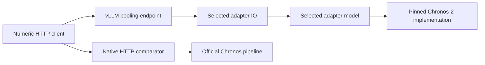

# Architecture

vTSFM is a general TSFM extension for vLLM. Chronos-2's
model and IO classes inherit the pinned community
integration. The project owns adapter discovery, plugin registration, compatibility
batching and optional TimesFM forecast-block scheduling. Execution preserves the
pinned upstream numerical behavior.

TimesFM 2.5, Toto 2 313M, and Moirai 2.0 small use `adapters/pooling.py` and
`adapters/multimodal.py` for the same whole-forecast execution pattern. TimesFM, Toto, and Moirai
all use a device-resident tensor path around the upstream decoder. Each adapter's `spec.py` owns its forecast
limits, defaults, and output
quantile order; shared IO consumes those settings. `hf_config.py` bridges the
upstream configuration files into vLLM without requiring a Transformers
implementation. These adapters expose independent univariate quantile forecasts.

The native and vLLM servers run sequentially on the same GPU during a comparison.
They are alternatives in this diagram, not simultaneous resident services.

## Code boundaries

| File / directory | Responsibility |
| --- | --- |
| `src/vtsfm/adapters/base.py` | Immutable, CPU-safe `AdapterSpec` metadata and lazy implementation paths |
| `src/vtsfm/adapters/registry.py` | `list_adapters()` and `get_adapter(name)` without model runtime imports |
| `src/vtsfm/adapters/chronos2/` | Chronos-2 pins, launch settings, model, numerical IO, and native comparator |
| `src/vtsfm/batching.py` | Runtime-independent reference planner for compatible prepared work and output routing |
| `src/vtsfm/execution.py` | CPU-safe prepared tensor, capability, and result contracts for future shared execution |
| `src/vtsfm/admission.py` | CPU-safe request/model-call limits and shared resident tensor accounting |
| `src/vtsfm/stepping.py` | CPU-safe resumable adapter contract and compatible block-call planning |
| `src/vtsfm/continuous_scheduler.py`, `block_worker.py`, `block_pooling.py` | Pinned V1 block scheduling, slot/lifecycle hooks, and active adapter state |
| `src/vtsfm/config.py` | Shared dependency pins/defaults and compatibility aliases for Chronos-2 model pins |
| `src/vtsfm/plugin.py` | Lazy architecture registration and adapter-selected IO factory for the `vtsfm` entry points |
| `src/vtsfm/adapters/transport.py`, `multimodal.py` | Request-preserving raw multimodal fields; single-request model execution remains the default |
| `src/vtsfm/adapters/result_transport.py` | Versioned self-describing forecast results; shared IO needs no pending metadata map |
| `src/vtsfm/cli.py` | Build commands/environments and start the selected backend without GPU imports for help |
| `src/vtsfm/models/chronos2.py`, `src/vtsfm/io_processor.py`, `src/vtsfm/native_server.py` | Compatibility shims for the previous implementation paths |
| `src/vtsfm/benchmark_memory.py` | Optional worker memory counters used in benchmark mode |
| `benchmarks/` | Data preparation, payloads, process ownership, metrics, raw results, plots |
| `scripts/` | Per-checkout setup, environment checks, serving, requests, smoke runs |
| `tests/` | CPU behavior checks; GPU serving verification runs separately |

## Adapter and plugin selection

An `AdapterSpec` describes a model family using its name, model ID/revision,
architectures, model and IO class paths, upstream IO plugin, native server module,
vLLM arguments, and group-attention capability. Descriptors contain metadata only;
listing adapters and resolving a descriptor must not import Torch, vLLM, or model
packages. Chronos-2's `supports_group_attention` is true: this describes the
inherited architecture, not a new vTSFM optimization.

`serve --adapter chronos2` selects the family independently of the backend
(`vtsfm`, `upstream`, or `native`; `chronos2` remains a legacy comparator alias).
The CLI sets `VTSFM_ADAPTER` explicitly; the IO
factory uses it to choose an implementation, defaulting to `chronos2`. Unknown
adapters fail before launching a server. `vtsfm adapters` lists descriptors as
CPU-safe JSON. These boundaries support extension, but do not yet define a common
public HTTP schema across model families.

The project registers `vtsfm` in the model plugin and IO processor entry-point
groups. The pinned Chronos package also registers `chronos2`. Serving must select
the intended entry point explicitly, so discovery order does not overwrite the
project's adapter with the community comparator.

The model plugin registers all descriptor architecture targets lazily. The
Chronos-2 model subclass has its own multimodal processor registration. This
registration is attached to the concrete model class and cannot be assumed to
follow ordinary Python subclass inheritance. Keep registration lazy so a CPU
checkout can import the package and inspect commands without importing vLLM or
Torch.

The Chronos-2 descriptor retains the pinned model revision, pooling runner,
numerical IO, FP32, eager execution, disabled prefix caching, and `max_num_seqs=1`.
Development RPC and memory hooks are enabled only in benchmark mode, not normal
serving. Bind to loopback unless access from another
machine is deliberately configured.

## Shared batching and model-specific execution

`batching.py` plans already prepared work using standard-library metadata. It has
no model-runtime dependency and does not import adapters. A `BatchKey` contains
the adapter, checkpoint ID/revision, context length, prediction length, quantile
levels, dtype, and canonical execution options. Keys must match exactly; differing shapes or settings remain
separate, even where a future adapter might safely combine them.
An empty quantile tuple represents point-only forecasts; shared planning does
not require an attention backbone or probabilistic model outputs.

A `BatchRequest` identifies a request and gives the prepared row count for each
independent attention group. `plan_batches(requests, max_rows=..., max_requests=...)`
produces FIFO contiguous plans, flushing on an incompatible key or a budget limit.
Requests and groups are atomic: an individually oversized request is rejected,
not split. Plans assign unique group IDs across requests, record request slices,
and `split_outputs(outputs)` routes row-aligned results back to those requests.
Invalid metadata and duplicate request IDs are rejected.

Each adapter owns normalization, patching, covariates, group formation (including
cross-learning semantics), and conversion between prepared rows and its public
outputs. Target/covariate filtering stays in adapter IO. Shared scheduling can
use the resulting compatibility keys, row counts, and group boundaries; it cannot
infer those numerical semantics. Attention kernels and other model execution
optimizations likewise belong inside the relevant adapter.

The planner produces CPU-testable metadata. Numerical serving feeds its plans
into the selected adapter's prepared executor under its cost policy. Queue admission and
attention kernels have separate boundaries.

Separately, the newer adapters' [numerical transport](numerical-transport.md)
uses batched multimodal fields to preserve multiple request payloads and stable
IDs at the pinned vLLM worker boundary. A checkpoint-free engine probe checks
this path. A pinned worker subclass resolves actual slot identities from cached
feature metadata, and the model/pooler route variable-size forecasts accordingly.
The pooled tensor carries each request's response metadata as well as FP32
forecast bytes. Stateless IO supports sequential offline DataPrompts and
concurrent HTTP requests without depending on postprocessing for cleanup; see
[request lifecycle](request-lifecycle.md).
Normal serving uses `max_num_seqs=1`. TimesFM, Toto, and Moirai expose concurrency
with `--max-num-seqs`. With `--forecast-batch-rows`, numerical adapters can combine
compatible requests that vLLM has already scheduled in the same worker forward.

The [prepared execution contract](execution-contract.md) binds a plan to validated
input tensors and defines row-aligned results, per-request splitting, and
conservative model capability metadata. 

Moirai implements the prepared executor for independent rows, including ragged lengths, and its live worker path uses the
same tensor forecast core for each scheduled request.

TimesFM implements the prepared
executor for equal-length independent rows. The runner supplies scheduled
requests in slot order. The shared execution helper plans batches, calls the
executor, and splits outputs by request ID before the pooler crops each slot.
Each adapter's [numerical admission policy](numerical-admission.md) checks request
cost before submission, validates scheduled residency at startup, and splits
compatible model calls by row/work budgets. The adapter owns its patch/block
cost formula and ceilings; other model families do not inherit them. Toto and
Moirai candidate caps still require the documented real-model GPU qualification.
The optional [continuous path](continuous-batching.md) resumes TimesFM between
forecast blocks. vLLM schedules one marker per block and returns results only at
completion. The adapter owns both flip-pass caches; shared policy bounds total
active state and individual packed calls.

## Benchmark contract

Each comparison uses native HTTP and one plugin (`vtsfm` or `chronos2`). The runner
starts and stops only its own children, refuses occupied ports and GPUs, and
does not terminate existing services. Backend loading and warmup happen outside
the timed interval. Cancellation must release owned children and preserve partial
results for inspection.

Requests use matching numerical inputs, prediction length 96, quantiles 0.1/0.5/0.9,
and `cross_learning=false`. B is the number of univariate sensor/history windows
in one request. The reference experiment sends sequential requests with one
outstanding HTTP request. It measures within-request batching; it does not test
cross-request planning/execution, grouped or covariate workloads, or
concurrent-client scalability.

End-to-end latency covers submitting a pre-encoded request through receiving and
decoding its response. Summary p95 pools the raw samples rather than averaging
block percentiles. Requests/s is the reciprocal of mean latency in seconds;
series/s is B divided by mean latency. With 150 samples per point, p95 depends on
a small tail and should not support strong claims about small differences.

GPU memory includes loaded/warmed service footprint and an NVML sampled peak.
The reference sampler interval is 20 ms, so it can miss short transients. Torch
allocated/reserved counters describe allocator state and are reported separately
from whole-service memory. Native in-process timing is a supplementary diagnostic,
not a symmetric model-only speedup measurement against vLLM.

### Input data

The default dataset is the [AssetOpsBench MetroPT fixture](https://github.com/IBM/AssetOpsBench/blob/e844f6468c6c68b328022e7ca8e31da140842cc7/src/couchdb/scenarios_data/shared/iot/metro_pump_1.json)
at commit `e844f6468c6c68b328022e7ca8e31da140842cc7`. The raw file's SHA256 is
`363d6daf873c614fcb4a798d4e86aa648d60ae2b6c735ce5d8388b0d4b3c2fdf`.
The AssetOpsBench paper identifies [MetroPT-3](https://doi.org/10.24432/C5VW3R)
compressor data as an upstream source. The exact raw-to-hourly aggregation recipe
is not documented in the inspected repository; the preparer performs no new
aggregation.

Seven analog channels share a 5,116-position hourly grid. All seven values are
missing in 560 rows. Preparation causally forward-fills these rows from preceding
observations, never future values, then casts to FP32. It preserves every observed
numeric value before that cast and records source checksums, timestamps,
per-channel metadata, and imputed indices in a provenance manifest.

The supported reference contexts are 128, 512, 2,048, and 4,096, with a 96-position
holdout. Windows from one compressor and overlapping history are correlated; they
are not independent assets. The experiment supports inference performance
comparisons and numerical backend parity checks, not forecasting-accuracy claims.
Synthetic numerical inputs are permitted only for explicitly labeled smoke tests.

## Future research boundaries

Cross-model batching, grouped attention kernels,
a common public numerical HTTP schema across all models, and MCP
integration are not implemented. Keep proposed changes behind clear boundaries
and demonstrate numerical parity before interpreting performance.
Any dependency, precision, scheduler, or IO change needs a separately labeled
baseline so results from different configurations do not become interchangeable.
